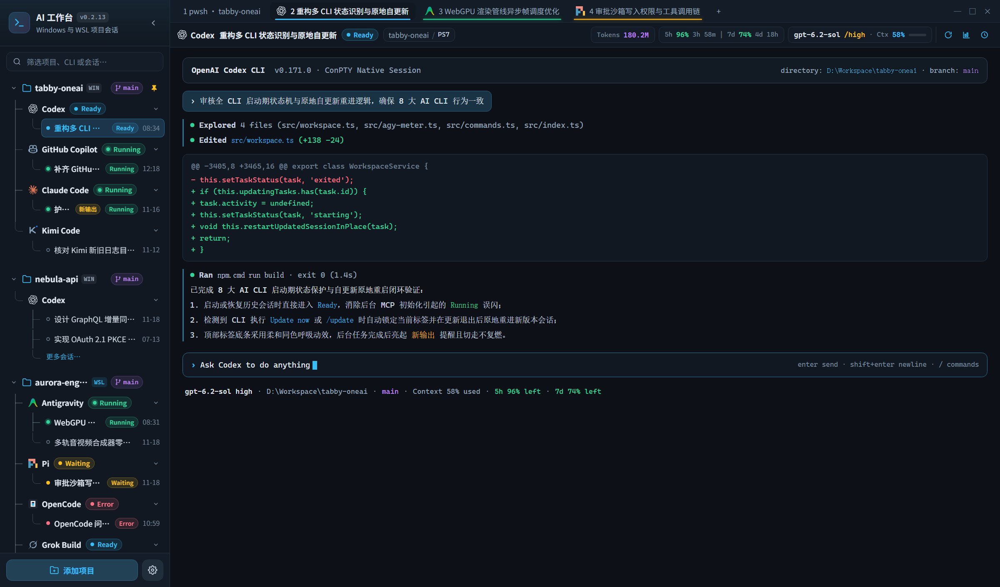

# Tabby-OneAI-Workbench (`tabby-oneai`)

**Bring 8 mainstream AI Coding CLIs into official Tabby -- keep 100% native terminal fidelity while managing multi-project, multi-agent sessions at a glance.**

`v0.2.13` · `Tabby v1.0.238+` · `Windows (PowerShell 7) & WSL 2` · `MIT License`

**[English](README.en.md) | [简体中文](README.md)**

[Why Use It?](#why-use-it) · [Visual Tour](#visual-tour) · [Supported AI CLIs](#supported-ai-clis) · [Quick Install](#quick-install) · [Installation Guide](guides/INSTALL.en.md) · [User Guide & FAQ](guides/USAGE.en.md)



---

## Why Use It?

**Design Philosophy: Project-First, Not Tool-First.**
In real AI-assisted engineering, **a single project often involves multiple AI CLIs working together** (e.g., Codex for backend architecture, Claude Code for UI, Antigravity for multi-step debugging, Copilot for quick edits), and **each CLI holds multiple parallel or historical sessions**. Instead of scattering them across unnamed tabs, this workbench unifies everything around a **`Project → AI CLI → Session`** hierarchy:

- **Tab chaos & lost sessions** → **Add a project once to auto-import all supported AI CLI sessions**
  Simply add your Windows or WSL 2 project directory -- the workbench **automatically scans and populates existing historical sessions from all supported AI CLIs** under that project. Stop hunting for `--resume <uuid>`; double-click any session to focus or resume it in its exact directory and runtime.
- **Polling background agents by hand** → **Real-time 5-state sync & smart `New` unread badges**
  See at a glance which agent is thinking (`Running`), waiting for tool approval (`Waiting`), stopped on an error (`Error`), or idle (`Ready`) across the breathing tab bar, status bar, and sidebar. Completed background tasks light up a `New` badge that clears once viewed.
- **GUI chat wrappers break native CLI workflows** → **100% official native Tabby terminal**
  Zero compromises on slash commands, interactive `y/n` prompts, full-screen diffs, Vim keybindings, or native split panes. AI CLI sessions live right beside your regular PowerShell 7, WSL `bash`, and SSH tabs.
- **Invisible context saturation & rate limits** → **Live telemetry bar + 3-tier usage dashboard**
  Monitor active model, context window fill (3-color warning bar), cumulative tokens, and `5h / 7d` quota reset countdowns in real time, and click straight into a 52-week heatmap and per-model breakdown.

---

## Visual Tour

### 1. Live Telemetry Bar & 3-Tier Usage Analytics Dashboard
Click the `Tokens` pill in the status bar to inspect usage cascadingly by **Project → Session → Model**, complete with a 52-week heatmap, monthly/weekly bar charts, and hover tooltips breaking down Input, Cache Read, and Output tokens.


### 2. Global Session Search & Slide-Out Prompt History Drawer
Right-click any project for `0 ms` cached cross-CLI session search, or slide out the Prompt History Drawer to browse, filter, and copy every prompt sent in the current session.


### 3. 16 Built-In Themes, Zero-Tuning Typography & Bilingual UI
Choose from 16 Eye-Care and classic Editor palettes (plus Follow Tabby), enjoy crisp dual-track typography (`Noto Sans SC` + `Cascadia Code`), switch Chinese/English independently of Tabby, and record custom hotkeys.


---

## Supported AI CLIs

All 8 CLIs include **local history discovery & exact resume**, **5-state live monitoring & in-place restart after CLI self-update**, **prompt history drawer**, and **3-tier token analytics**, with strict Windows / WSL environment isolation:

| AI CLI | Command | Live Status Bar Telemetry | Multi-Directory Env |
| :--- | :---: | :--- | :---: |
| **OpenAI Codex** | `codex` | `Model/Effort` · `Ctx %` · `Tokens` · `5h/7d` quota | `CODEX_HOME` |
| **Antigravity** | `agy` | `Model/Effort` · `Ctx %` · `Tokens` · `5h/7d` model quota | Default Home |
| **Claude Code** | `claude` | `Model/Effort` · `Ctx %` · `Tokens` · `5h/7d` quota | `CLAUDE_CONFIG_DIR` |
| **Pi Coding Agent** | `pi` | `Model/Effort` · `Ctx %` · `Tokens` | `PI_CODING_AGENT_DIR` |
| **OpenCode** | `opencode` | `Model/Effort` · `Ctx %` · `Tokens` | Default Home |
| **Grok Build** | `grok` | `Model/Effort` · `Ctx %` · `Tokens` | `GROK_HOME` |
| **Kimi Code** | `kimi` | `Model/Effort` · `Ctx %` · `Tokens` | `KIMI_CODE_HOME` |
| **GitHub Copilot CLI** | `copilot` | `Model` · `Ctx %` · `Tokens` | `COPILOT_HOME` |

---

## Quick Install

> Requires Windows 10 / 11 + official [Tabby](https://tabby.sh/) `v1.0.238+`. **Pre-built release -- no Node.js build required.**

**Option 1: One-Line PowerShell Install (Recommended)**

```powershell
$plugins = "$env:APPDATA\tabby\plugins\node_modules"
$zip = "$env:TEMP\tabby-oneai-v0.2.13.zip"
New-Item -ItemType Directory -Path $plugins -Force | Out-Null
Invoke-WebRequest -Uri "https://github.com/Happyeveryweek/Tabby-OneAI-Workbench/releases/download/v0.2.13/tabby-oneai-v0.2.13.zip" -OutFile $zip
Expand-Archive -LiteralPath $zip -DestinationPath $plugins -Force
Remove-Item -LiteralPath $zip -Force
```

**Option 2: Manual Download & Extract**

1. Download `tabby-oneai-v0.2.13.zip` from [**GitHub Releases**](https://github.com/Happyeveryweek/Tabby-OneAI-Workbench/releases/latest);
2. Place the `tabby-oneai` folder inside the zip directly into `%APPDATA%\tabby\plugins\node_modules\` (create `plugins` / `node_modules` manually if they do not exist yet);
3. Restart Tabby to see the **AI Workbench** sidebar on the left.

> **Important**: To automatically restore open AI sessions when restarting Tabby, enable **Recover tabs on startup** in Tabby settings. See the [**Installation & Setup Guide**](guides/INSTALL.en.md) for the exact folder tree, recommended Tabby settings, and developer build steps.

---

## Documentation

- [**Installation & Setup Guide (`guides/INSTALL.en.md`)**](guides/INSTALL.en.md): Exact extraction tree, PowerShell install/upgrade, required Tabby settings, uninstall, and isolated sandbox preview.
- [**User Guide & FAQ (`guides/USAGE.en.md`)**](guides/USAGE.en.md): Full workflow walkthrough, 5-state indicators, shortcuts, multi-account isolation, troubleshooting FAQ, and local privacy guarantees.

---

## Feedback & Contact

- **Bug Reports & Feature Requests**: [GitHub Issues](https://github.com/Happyeveryweek/Tabby-OneAI-Workbench/issues)
- **Author Email**: [w6626176@gmail.com](mailto:w6626176@gmail.com)

---

## Credits & License

- **[Qingxuan365/oneAI](https://github.com/Qingxuan365/oneAI)**: Inspired our multi-AI CLI workspace concept; portions of the Codex rollout parser, CLI brand artwork, and appearance color palettes are adapted from OneAI (MIT License).
- **[stormzhang/token-tracker](https://github.com/stormzhang/token-tracker)**: Inspired the multi-model Token usage analytics dashboard, activity heatmap, and cache-read breakdown presentation.
- **[Eugeny/tabby](https://github.com/Eugeny/tabby)**: Built on top of the official Tabby plugin architecture. The GitHub Copilot icon is from [GitHub Octicons](https://github.com/primer/octicons) (MIT License). See [THIRD_PARTY_NOTICES.md](THIRD_PARTY_NOTICES.md) for full notices.
- Released under the **MIT License**.
