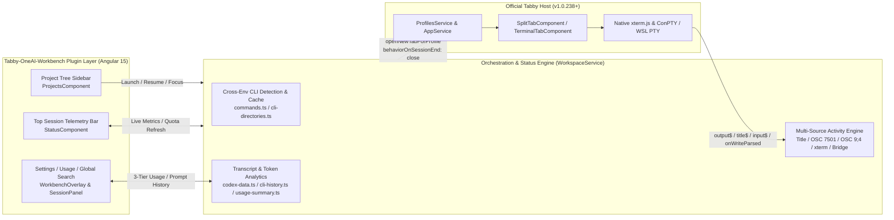

# Tabby-OneAI-Workbench (`tabby-oneai`)

**Turn official Tabby into a project-centric command center for 8 mainstream AI Coding CLIs -- aggregating multi-agent workflows across Windows & WSL 2 with zero compromise on native terminal and TUI features.**

`Version v0.2.13` · `Tabby v1.0.238+` · `Windows (PowerShell 7) & WSL 2` · `MIT License`

**[English](README.en.md) | [简体中文](README.md)**

[Why This Plugin?](#why-tabby-oneai-workbench) · [Supported AI CLIs](#supported-ai-clis) · [Key Features](#key-features) · [Architecture](#architecture--workflow) · [Quick Start](#installation--quick-start) · [Shortcuts](#default-keyboard-shortcuts)


---

## Why Tabby-OneAI-Workbench?

Modern AI-assisted engineering rarely relies on a single tool. When you run **Codex**, **Claude Code**, **Antigravity (`agy`)**, **OpenCode**, **GitHub Copilot CLI**, **Pi**, **Kimi Code**, and **Grok Build** across multiple **Windows folders** and **WSL 2 distributions**, you quickly hit a wall between chaotic terminal tabs and restrictive GUI wrappers:

- **End Terminal Tab Chaos → Persistent `Project → CLI → Session` Sidebar Tree**
  Opening a dozen tabs makes it impossible to tell which tab belongs to which repo, WSL distro, or AI CLI. The workbench automatically groups live tasks and local CLI histories under their Windows (`PS7`) or Linux (`WSL · <distro>`) project directories -- double-click any item to focus a live pane or resume the exact historical session in place.
- **No Compromised GUI Wrappers → 100% Native Tabby Terminal & Full TUI Fidelity**
  Third-party chat wrappers strip away slash commands, interactive permission prompts (`y/n`), subagent trees, full-screen diffs, and native split panes. Here every session runs directly inside Tabby's native ConPTY / WSL PTY terminal, side-by-side with your regular PowerShell 7, WSL `bash`, and SSH tabs.
- **Eliminate Background Blind Spots → 5-State Real-Time Engine & Smart `New` Badges**
  Tracks `Running`, `Waiting` (tool approval needed), `Ready`, `Error` (turn stopped on error), and `Exited` simultaneously across the tab bar's bottom `.colorbar` (soft same-color breathing glow), the session telemetry bar, sidebar group pills, and session dots. Background completions light up a `New` (`新输出`) badge that clears on focus and never falsely re-triggers.
- **Turn Opaque Quotas & Token Burn into Live Telemetry → Status Bar + `1100 × 800` Usage Dashboard**
  View live `Tokens`, `5h / 7d` remaining quota & reset timers, `Model / Effort`, and a 3-color `Ctx` progress bar right below the tab bar. Click to open a 3-tier cascading (`Project → Session → Model`) analytics dashboard with a 52-week heatmap, daily bar charts, and cache-read breakdown tooltips.

---

## Supported AI CLIs

The workbench strictly isolates Windows (PowerShell 7) and WSL 2 environments (filtering out mounted `/mnt/*` host binaries inside WSL and VS Code `copilot-shim` stubs while automatically resolving user-level CLI paths such as `~/.opencode/bin`, `~/.local/bin`, `~/.bun/bin`, and `~/.cargo/bin`), showing only the CLIs installed in each project's runtime environment.

**Universal Capabilities Across All 8 CLIs**:
- **Local History Discovery & Exact Resume**: Automatically scans local transcript directories, resumes historical sessions by ID on double-click, and live-binds newly started sessions after the first turn.
- **5-State Live Activity & In-Place Self-Update Restart**: Full `Running / Waiting / Ready / Error / Exited` synchronization, plus automatic in-place relaunch in the same tab after an in-CLI self-update (`Update now` / `/update`).
- **Prompt History Drawer & 3-Tier Usage Analytics**: Every CLI integrates with the slide-out prompt history drawer (search / expand / copy) and the `1100 × 800` token usage analytics dashboard.

| AI CLI | Command | Live Status Bar Telemetry | Multi-Directory Env |
| :--- | :---: | :--- | :---: |
| **OpenAI Codex** | `codex` | `Model/Effort` · `Ctx %` · `Tokens` · `5h/7d` live & local quota | `CODEX_HOME` |
| **Antigravity** | `agy` | `Model/Effort` · `Ctx %` · `Tokens` · `5h/7d` dynamic model quota | Default Home |
| **Claude Code** | `claude` | `Model/Effort` · `Ctx %` · `Tokens` · `5h/7d` rate limits | `CLAUDE_CONFIG_DIR` |
| **Pi Coding Agent** | `pi` | `Model/Effort` · `Ctx %` · `Tokens` (JSONL + live footer) | `PI_CODING_AGENT_DIR` |
| **OpenCode** | `opencode` | `Model/Effort` · `Ctx %` · `Tokens` (v2 export schema) | Default Home |
| **Grok Build** | `grok` | `Model/Effort` · `Ctx %` · `Tokens` | `GROK_HOME` |
| **Kimi Code** | `kimi` | `Model/Effort` · `Ctx %` · `Tokens` (new & legacy home) | `KIMI_CODE_HOME` |
| **GitHub Copilot CLI** | `copilot` | `Model` · `Ctx %` · `Tokens` | `COPILOT_HOME` |

---

## Key Features

### 1. Cross-Environment Project Tree (Windows PowerShell 7 & Multi-Distro WSL 2)
- **3-Tier Rounded Connector Tree**: Organizes `Project → CLI Group → Session` with clean two-level rounded tree connectors, resizable sidebar width, collapsible narrow Rail mode, and instant keyword filtering.
- **Runtime & Git Awareness**: Displays `PS7` or `WSL · <distro>` badges (automatically distinguishing multiple WSL distributions), current Git branch pills, one-click project pinning, and a context-menu action to **Open Project Folder** in Windows Explorer (automatically translating WSL paths to `\\wsl.localhost\...`).
- **Live Binding for New Sessions**: Starting a brand-new session in any supported AI CLI automatically binds to the newly created transcript file on disk as soon as your first turn is recorded, updating the sidebar title, prompt history drawer, and token metrics in real time.
- **Progressive Session Lists & 0ms Global History Search**: Each CLI group shows the latest `2` sessions by default with `+3` step expansion and one-click collapse. Right-click any project or CLI group to open **Search Session History…** with `0 ms` in-memory cached rendering, CLI filter pills, and background incremental scanning.

### 2. Unified Real-Time Status & Lifecycle Protection
- **5 Semantic Runtime States**:
  - `Running` (Emerald `#20b782`): The agent is actively thinking, executing tools, or running background subagents (`1 task(s) · /tasks`). The tab's bottom `.colorbar` displays a calm `2.2s` same-color breathing glow (free of harsh white flashes).
  - `Waiting` (Amber `#cf920c` / `#d99b18`): The CLI is waiting for user confirmation or tool permission (`Allow once`, `[y/n]`).
  - `Ready` / `Online` (Cyan-Blue `#5a9de1`): The session is idle at the prompt waiting for input (with startup-phase protection so newly opened or resumed sessions settle straight into `Ready` without falsely flashing `Running` during MCP initialization or history replay).
  - `Error` / `Failed` (Coral Red `#e26070`): The turn stopped on an API, quota, or authentication error (automatic retries remain `Running` without false red alerts; clears automatically on the next turn).
  - `Exited` (Hollow Grey Ring `#808893`): Historical or closed session. Exiting any CLI via `Ctrl+C`, `Esc`, or `/exit` automatically closes the terminal tab/pane (matching the tab bar's `×` close behavior) and marks the sidebar entry as `Exited`.
- **Seamless In-Place Auto-Restart After CLI Self-Update**: When any AI CLI prompts `Update available -> Update now` (or runs `/update` / `/upgrade`), the workbench automatically switches to `Running` and locks the tab from closing; once the update succeeds and the old CLI process exits, it **automatically relaunches the newly updated CLI in-place inside the same tab** and resumes your session (preserving the terminal output if the update fails).
- **False-Positive-Free `New` (`新输出`) Badges**: Background tabs only light up `New` when genuine background work or an approval prompt occurs while unfocused. Once you have viewed a completed reply, switching away to another AI CLI, WSL shell, or PowerShell tab will never falsely re-trigger `New` from idle ANSI redraws or footer countdown ticks.
- **Active Execution Close Guard**: Closing a tab or the Tabby window while tasks are `Running`, `Waiting`, or `Starting` prompts for confirmation before terminating active agents.

### 3. Dynamic Telemetry Bar & `1100 × 800` Usage Analytics Dashboard
- **Capability-Driven Status Bar**: Mounted directly below Tabby's tab bar, rendering only the metric pills actually supported and populated by the active CLI (zero empty `—` placeholders):
  - `Tokens` cumulative counter (click to jump straight to that session's usage analytics);
  - `5h` / `7d` remaining quota percentage (color-coded green/amber/red) with reset countdowns and one-click online quota refresh for Codex;
  - `Model / Effort` active model and reasoning effort badge;
  - `Ctx` context window utilization percentage with a 3-tier color mini-bar (`<55%` blue, `55%–80%` amber, `≥80%` red).
- **3-Tier Cascading Usage Dashboard**:
  - Filter cascadingly by **Project → Session → Model** across **Last 12 Months / This Month / This Week** (with period token totals on each pill);
  - **4 Core KPI Cards**: Total Tokens, Cache Read Share, Active Sessions, and Active Days;
  - **Adaptive Activity Chart**: 52-week GitHub-style activity heatmap for the 12-month view, automatically switching to daily token bar charts for Monthly and Weekly views;
  - **Model Breakdown & Hover Tooltips**: Hover over any segment of the distribution bar or model table to inspect exact Input, Output, Cache Read, and Cache Write / Reasoning token splits.


### 4. Slide-Out Prompt History Drawer & Non-Destructive Session Management
- **Prompt History Drawer**: Slides out below the session status bar (avoiding window control buttons), listing all user prompts in reverse chronological order with keyword search, long-prompt expand/collapse, and one-click full-text copy.
- **Non-Destructive Removal & Recovery**: Removing a project or session from the workbench never deletes your underlying CLI transcript files. Visit **Settings → Session Management** to filter removed sessions by project (`PS7` / `WSL`), CLI, or keyword, and restore individual items or entire project groups in one click.


### 5. Dual-Track Zero-Tuning Typography, 16 Themes & Bilingual UI
- **Dual-Track Font Stack**: Uses `Noto Sans SC` (`13 px`, `0.0 px` letter spacing out of the box) for crisp UI text and `Cascadia Code` for numeric/code badges (`version`, `branch`, `Tokens`, `Ctx`). Supports searching any installed system font and automatically tightens letter spacing (`-0.9 px`) and word spacing when wide CJK monospace fonts (`Maple Mono NF CN`, `Sarasa Mono SC`) are selected.
- **16 Built-In Palettes**: Includes Follow Tabby, Light, Dark, 6 Eye-Care palettes (Bean Green, Lavender, Mist Grey, Nord Blue, Forest Night, Ink Night), and 10 Editor palettes (Darcula, Sublime Material, Monokai, Mariana, Solarized Dark/Light, IntelliJ Light, IDEA Light, Kiro Dark/Light) with opaque backdrop protection for transparent/acrylic Tabby windows.
- **Independent Language & Recordable Hotkeys**: Switch between **简体中文** and **English** independently of Tabby's host language, and record custom hotkeys (`Ctrl-Alt-Shift-H/U/O/B` presets with conflict detection and one-click reset).


---

## Architecture & Workflow



---

## Installation & Quick Start

### Prerequisites

- **OS**: Windows 10 / 11 (64-bit)
- **Host Application**: Official [Tabby](https://tabby.sh/) `v1.0.238+`
- **Runtime**: Windows PowerShell 7 (`pwsh.exe`) and optional WSL 2 distributions (e.g., `Ubuntu-24.04`)

### Option 1: Install Pre-Built Package from GitHub Releases (Recommended)

No Node.js build required -- download the ready-to-use plugin archive directly:

#### 1. Manual Unzip (Step-by-Step)

1. Go to [**GitHub Releases**](https://github.com/Happyeveryweek/Tabby-OneAI-Workbench/releases/latest) and download **`tabby-oneai-v0.2.13.zip`**;
2. Press `Win + R`, enter **`%APPDATA%\tabby`**, and press Enter to open Tabby's configuration directory, then navigate into `plugins` → `node_modules`:
   - **If the `plugins` or `node_modules` folder does not exist yet** (common on a fresh Tabby install), manually create the `plugins` folder inside `%APPDATA%\tabby`, and then create a `node_modules` folder inside `plugins`;
3. **The zip archive already contains the top-level `tabby-oneai` folder**. Place that `tabby-oneai` folder directly inside `node_modules` (**keep the `tabby-oneai` directory level, and make sure not to nest an extra folder like `tabby-oneai-v0.2.13\tabby-oneai` or `tabby-oneai\tabby-oneai`**). Your final directory tree should look exactly like this:

```text
%APPDATA%\tabby\plugins\node_modules\
└── tabby-oneai\                <-- Keep this tabby-oneai folder inside node_modules
    ├── package.json
    ├── THIRD_PARTY_NOTICES.md
    └── dist\
        ├── index.js
        └── ...
```

4. Restart Tabby. The **AI Workbench (`v0.2.13`)** sidebar will appear on the left.

#### 2. Or One-Line PowerShell Install

Run the following snippet in PowerShell to automatically download and extract the latest release into Tabby's plugins directory:

```powershell
$plugins = "$env:APPDATA\tabby\plugins\node_modules"
$zip = "$env:TEMP\tabby-oneai-v0.2.13.zip"
New-Item -ItemType Directory -Path $plugins -Force | Out-Null
Invoke-WebRequest -Uri "https://github.com/Happyeveryweek/Tabby-OneAI-Workbench/releases/download/v0.2.13/tabby-oneai-v0.2.13.zip" -OutFile $zip
Expand-Archive -LiteralPath $zip -DestinationPath $plugins -Force
Remove-Item -LiteralPath $zip -Force
```

<details>
<summary><b>Option 2: Build from Source or Run an Isolated Preview Sandbox (For Developers)</b></summary>

Requires **Node.js `18+`**:

```powershell
# 1. Install dependencies and compile TypeScript
npm.cmd ci
npm.cmd run build

# 2. Option A: Launch an isolated preview Tabby window (does not touch your daily Tabby profile)
.\scripts\Preview-Tabby.ps1

# 3. Option B: Sync build output to your local Tabby plugins directory
$target = "$env:APPDATA\tabby\plugins\node_modules\tabby-oneai"
New-Item -ItemType Directory -Path "$target\dist" -Force | Out-Null
Copy-Item -LiteralPath package.json, THIRD_PARTY_NOTICES.md -Destination $target -Force
Copy-Item -Path dist\* -Destination "$target\dist" -Recurse -Force
```

</details>

---

## Default Keyboard Shortcuts

All hotkeys can be recorded, cleared, or reset to defaults in **Workbench Settings → Shortcuts** (persisted directly to Tabby's `config.store.hotkeys`):

| Action | Default Shortcut |
| :--- | :--- |
| Toggle Prompt History Drawer | `Ctrl-Alt-Shift-H` |
| Open Session / Project Usage Analytics | `Ctrl-Alt-Shift-U` |
| Open Workbench Settings | `Ctrl-Alt-Shift-O` |
| Collapse / Expand Project Sidebar | `Ctrl-Alt-Shift-B` |

---

## Privacy & Security

- **100% Local Read-Only Parsing**: All session histories, prompt drawers, and token usage statistics are parsed locally from your Windows or WSL CLI data directories. No code, prompts, or telemetry are ever sent to any external server.
- **Zero Credential Harvesting**: API keys, OAuth tokens, and login states are managed exclusively by each AI CLI. The plugin never writes secrets, credentials, or terminal scrollback contents into project files or logs.
- **Scoped Persistence**: Project lists, task bindings, appearance settings, and custom CLI directory mappings are stored locally inside the active Tabby profile's `localStorage`.

---

## Feedback & Contact

- **Bug Reports & Feature Requests**: [GitHub Issues](https://github.com/Happyeveryweek/Tabby-OneAI-Workbench/issues)
- **Author Email**: [w6626176@gmail.com](mailto:w6626176@gmail.com)

---

## Credits & License

- Portions of the Codex rollout/usage parser, CLI brand artwork, and appearance color palettes are adapted from [OneAI](https://github.com/Qingxuan365/oneAI) (MIT License). The GitHub Copilot icon is from [GitHub Octicons](https://github.com/primer/octicons) (MIT License). See [THIRD_PARTY_NOTICES.md](THIRD_PARTY_NOTICES.md) for full notices.
- Built on top of the official [Tabby](https://github.com/Eugeny/tabby) plugin architecture.
- Released under the **MIT License**.
