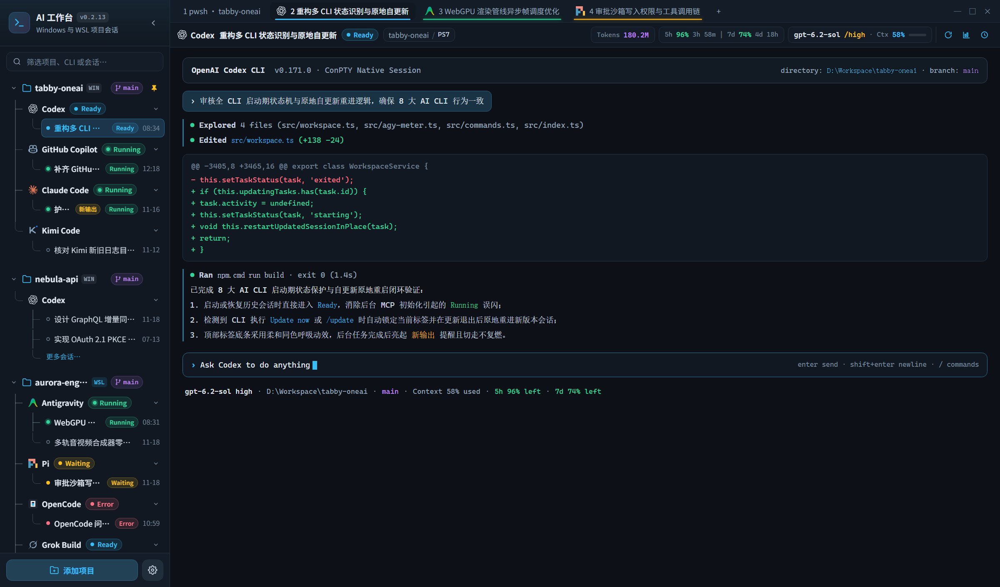
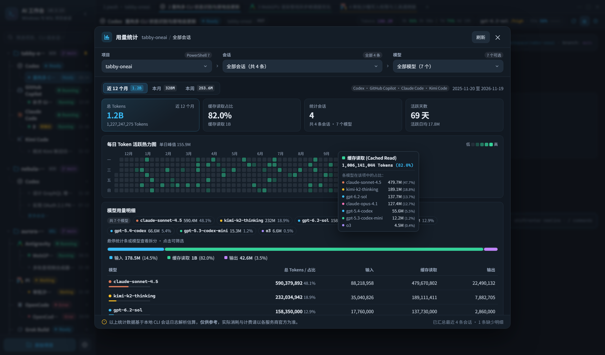
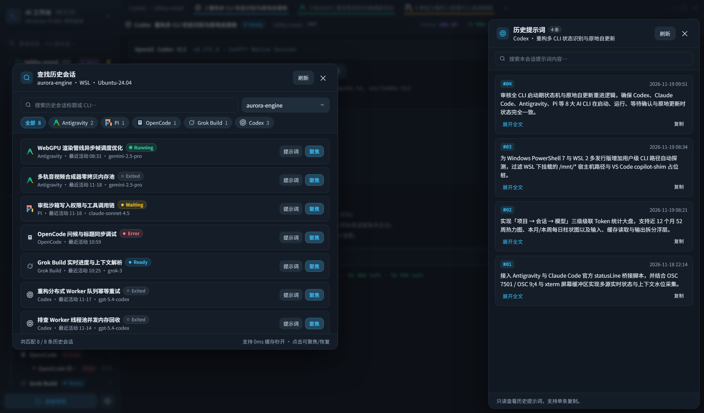
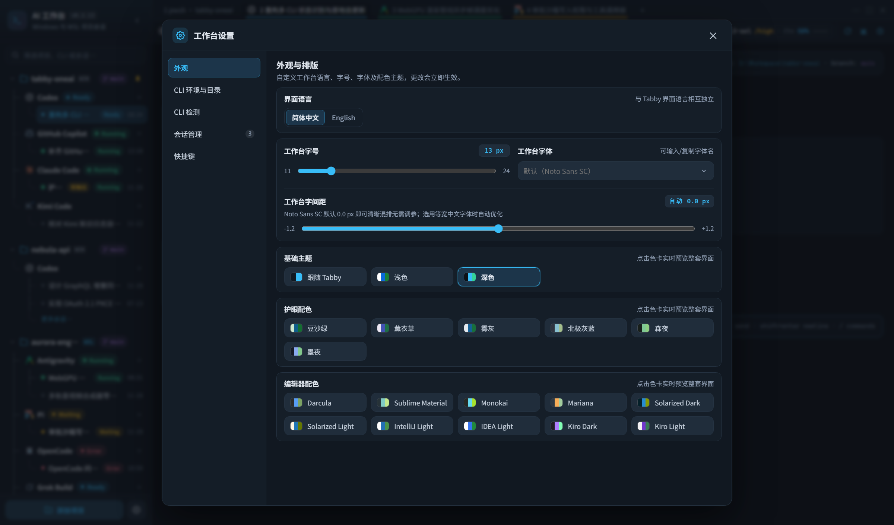

# Tabby-OneAI-Workbench (`tabby-oneai`)

**把 8 大主流 AI Coding CLI 收拢进官方 Tabby -- 不换终端、零功能阉割，让多项目、多 Agent 并行开发一眼可控**

`v1.0.3` · `Tabby v1.0.238+` · `Windows (PowerShell 7) & WSL 2` · `MIT License`

**[简体中文](README.md) | [English](README.en.md)**

[为什么用它](#为什么用它) · [核心界面预览](#核心界面预览) · [支持的 AI CLI](#支持的-8-大-ai-cli) · [快速安装](#快速安装) · [安装手册](guides/INSTALL.md) · [使用手册与常见问题](guides/USAGE.md)



---

## 为什么用它

**设计理念：以「项目」为基准，而不是以单个 CLI 为中心。**
在真实的 AI 辅助研发中，**一个项目下往往会同时用多个 AI CLI 协作写代码**（例如用 Codex 重构核心逻辑、Claude Code 写界面、Antigravity 做多步联调、Copilot 做局部修改），而**每个 AI CLI 下又会并行或留存多个独立会话**。传统终端把这些会话打散在一堆无序标签里，本插件用 **`项目 → AI CLI → 会话`** 三层工作台把它们彻底收拢：

- **终端标签越开越乱，历史会话找不到** → **添加项目即自动归集所有支持的 AI CLI 会话，双击秒续聊**<br>
  你只需手动添加一次项目目录（Windows 或 WSL 2），工作台就会**自动扫描并导入该目录下所有已支持 AI CLI 的历史会话**，按 `项目 → CLI → 会话` 归类展示；不用再翻历史或手敲 `--resume <id>`，双击即按原目录、原环境精准恢复。
- **后台同时跑 3--5 个 Agent，全靠切标签轮询** → **全界面实时状态联动 + 精准「新输出」提醒**<br>
  正在思考（`Running`）、卡在权限审批（`Waiting`）、报错停止（`Error`）、已经就绪（`Ready`）在顶部标签呼吸条、状态栏与侧栏同步呈现；后台任务完成后自动亮起「新输出」，切回看完即消，无需反复盯屏。
- **不想被第三方套壳客户端阉割 CLI 能力** → **100% 官方原生 Tabby 终端，零妥协**<br>
  不是把 CLI 塞进网页聊天框的套壳工具。每个会话都在原生 Tabby 终端中运行，完整保留斜杠命令、交互审批（`y/n`）、全屏 Diff、Vim 键位、分屏（Split Tab），并与普通 PowerShell / WSL / SSH 标签无缝共存。
- **长对话不知不觉打满上下文或触发限额** → **顶部实时状态栏 + 多维 Token 用量账单**<br>
  状态栏实时展示当前模型、上下文占用（三色预警）、累计 Tokens 与 `5h / 7d` 剩余额度倒计时；点击直达年度热力图与「项目 → 会话 → 模型」三级消耗明细。

---

## 核心界面预览

### 1. 实时指标状态栏与三级级联用量大盘
点击顶部 `Tokens` 胶囊即可打开用量统计大盘，支持按 **项目 → 会话 → 模型** 级联筛选、近 12 个月 52 周热力图、本月/本周柱状图，以及悬停查看输入 / 缓存读取 / 输出精确拆分。



### 2. 全局历史会话检索与右侧提示词抽屉
右键任意项目即可 `0 ms` 秒开跨 CLI 历史会话搜索；随时拉出右侧「历史提示词」抽屉，倒序回看、搜索并一键复制本会话发过的所有 Prompt。



### 3. 16 套主题配色、免调参字体与独立中英双语
内置护眼配色与经典编辑器配色（共 16 套 + 跟随 Tabby），默认双轨免调参字体（`Noto Sans SC` + `Cascadia Code`），支持独立于 Tabby 主程序的中英文切换与可视化快捷键录制。



---

## 支持的 8 大 AI CLI

所有 CLI 均支持 **本地历史扫描与双击精准恢复**、**五态实时运行监控与自更新原地重启**、**历史提示词抽屉** 及 **三级用量统计大盘**，且严格隔离 Windows 与各 WSL 发行版环境：

| AI CLI | 命令 | 状态栏实时指标 | 多目录 / 多账号变量 |
| :--- | :---: | :--- | :---: |
| **OpenAI Codex** | `codex` | `Model/Effort` · `Ctx %` · `Tokens` · `5h/7d` 额度 | `CODEX_HOME` |
| **Antigravity** | `agy` | `Model/Effort` · `Ctx %` · `Tokens` · `5h/7d` 多模型额度 | 环境默认目录 |
| **Claude Code** | `claude` | `Model/Effort` · `Ctx %` · `Tokens` · `5h/7d` 额度 | `CLAUDE_CONFIG_DIR` |
| **Pi Coding Agent** | `pi` | `Model/Effort` · `Ctx %` · `Tokens` | `PI_CODING_AGENT_DIR` |
| **OpenCode** | `opencode` | `Model/Effort` · `Ctx %` · `Tokens` | 环境默认目录 |
| **Grok Build** | `grok` | `Model/Effort` · `Ctx %` · `Tokens` | `GROK_HOME` |
| **Kimi Code** | `kimi` | `Model/Effort` · `Ctx %` · `Tokens` | `KIMI_CODE_HOME` |
| **GitHub Copilot CLI** | `copilot` | `Model` · `Ctx %` · `Tokens` | `COPILOT_HOME` |

---

## 快速安装

> 适用于 Windows 10 / 11 + 官方 [Tabby](https://tabby.sh/) `v1.0.238+`，**免编译、无需安装 Node.js**。

**方式一：PowerShell 一键下载安装（推荐）**

```powershell
$plugins = "$env:APPDATA\tabby\plugins\node_modules"
$zip = "$env:TEMP\tabby-oneai-v1.0.3.zip"
New-Item -ItemType Directory -Path $plugins -Force | Out-Null
Invoke-WebRequest -Uri "https://github.com/Happyeveryweek/Tabby-OneAI-Workbench/releases/download/v1.0.3/tabby-oneai-v1.0.3.zip" -OutFile $zip
Expand-Archive -LiteralPath $zip -DestinationPath $plugins -Force
Remove-Item -LiteralPath $zip -Force
```

**方式二：手动下载压缩包解压**

1. 从 [**GitHub Releases**](https://github.com/Happyeveryweek/Tabby-OneAI-Workbench/releases/latest) 下载 `tabby-oneai-v1.0.3.zip`；
2. 将压缩包内自带的 `tabby-oneai` 文件夹放入 `%APPDATA%\tabby\plugins\node_modules\`（若没有 `plugins` 或 `node_modules` 目录请先手动新建）；
3. 重启 Tabby 即可在左侧看到 **AI 工作台**。

> **重要提示**：如需在重启 Tabby 后自动恢复上次打开的 AI 会话，请开启 Tabby 的 **「启动时恢复上次打开的标签页」**。详细目录结构图示、必做配置与源码编译方式见 [**安装与环境配置手册**](guides/INSTALL.md) 。

---

## 文档导航

- [**安装与环境配置手册 (`guides/INSTALL.md`)**](guides/INSTALL.md)：手动解压目录层级图、PowerShell 一键安装/升级、必做 Tabby 配置路径、卸载与开发者沙箱调试。
- [**使用手册与常见问题 (`guides/USAGE.md`)**](guides/USAGE.md)：完整上手指南、五态标识说明、快捷键、多账号隔离、常见问题排查与 100% 本地隐私说明。

---

## 反馈与联系

- **问题反馈 / 功能建议**：欢迎提交 [GitHub Issues](https://github.com/Happyeveryweek/Tabby-OneAI-Workbench/issues)
- **作者联系邮箱**：[w6626176@gmail.com](mailto:w6626176@gmail.com)

---

## 致谢与开源许可

- **[Qingxuan365/oneAI](https://github.com/Qingxuan365/oneAI)**：参考了其多 AI CLI 工作台设计理念，并迁移改编了部分 Codex 会话解析、CLI 品牌图标与主题色板（MIT License）。
- **[stormzhang/token-tracker](https://github.com/stormzhang/token-tracker)**：参考了其多模型 Token 用量统计看板、活跃热力图与缓存命中拆分的数据呈现设计。
- **[Eugeny/tabby](https://github.com/Eugeny/tabby)**：宿主终端扩展能力构建于官方 Tabby 插件架构之上；GitHub Copilot 图标来自 [GitHub Octicons](https://github.com/primer/octicons)（MIT License）。完整第三方声明见 [THIRD_PARTY_NOTICES.md](THIRD_PARTY_NOTICES.md) 。
- 本项目基于 **MIT License** 开源。
