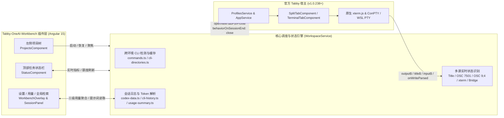

# Tabby-OneAI-Workbench (`tabby-oneai`)

**将官方 Tabby 升级为面向多 AI Coding CLI 的项目级终端工作台 -- 聚合 8 大主流 AI CLI，零妥协保留 100% 原生终端与 TUI 能力**

`Version v0.2.13` · `Tabby v1.0.238+` · `Windows (PowerShell 7) & WSL 2` · `MIT License`

**[简体中文](README.md) | [English](README.en.md)**

[核心痛点与方案](#为什么需要-tabby-oneai-workbench) · [支持的 8 大 AI CLI](#支持的-8-大-ai-cli) · [核心特性](#核心特性) · [架构与工作流](#架构与工作流) · [安装与快速开始](#安装与快速开始) · [默认快捷键](#默认快捷键)


---

## 为什么需要 Tabby-OneAI-Workbench

当你在日常开发中同时使用 **Codex**、**Claude Code**、**Antigravity (`agy`)**、**OpenCode**、**GitHub Copilot CLI**、**Pi**、**Kimi Code** 或 **Grok Build**，并且项目分散在 **Windows 本地目录**与多个 **WSL 2 发行版**中时，往往会遇到以下痛点：

- **告别原生终端标签混乱 → 「项目 → CLI → 会话」三层常驻工作台**
  传统终端开十几个标签页后，分不清哪个标签属于哪个项目、哪个 WSL 环境或哪个 AI CLI，找回半天前的会话只能手敲 `--resume <uuid>`。本插件在左侧按项目与运行环境（`PS7` / `WSL · <distro>`）自动归集所有在线任务与本地历史会话，双击即可按原目录、原环境变量与原会话 ID 精准恢复。
- **拒绝第三方 GUI 壳阉割功能 → 100% 原生 Tabby 终端，零 TUI 折损**
  把 CLI 包装成网页聊天框的客户端往往会破坏斜杠命令、交互式权限确认（`y/n`）、子 Agent 树、全屏 Diff 与终端分屏。本插件让每个会话直接在 Tabby 原生 ConPTY / WSL PTY 中运行，与普通 PowerShell 7、WSL `bash`、SSH 标签页及原生分屏（Split Tab）无缝共存。
- **消除多任务并行盲区 → 全链路五态实时识别与精准「新输出」提醒**
  后台同时跑多个 Agent 时，统一识别 `Running`、`Waiting`（等待审批）、`Ready`、`Error`（报错停止）与 `Exited`，在顶部标签底条（柔和同色呼吸动效）、会话状态栏、侧栏分组胶囊与会话圆点四处同步联动；后台任务完成自动亮起「新输出」，查看后切走绝不误复燃。
- **打破额度与 Token 黑盒 → 实时指标状态栏 + `1100 × 800` 用量统计大盘**
  状态栏实时展示 `Tokens`、`5h / 7d` 剩余额度与重置倒计时、`Model / Effort` 及三色预警 `Ctx` 上下文进度条；支持按「项目 → 会话 → 模型」三级级联查看 52 周活跃热力图、每日柱状图与缓存命中明细。

---

## 支持的 8 大 AI CLI

插件严格隔离 Windows（PowerShell 7）与各 WSL 发行版环境（自动过滤 WSL 下挂载的 `/mnt/*` 宿主机路径与 VS Code `copilot-shim` 占位桩，自动补齐 `~/.opencode/bin`、`~/.local/bin`、`~/.bun/bin`、`~/.cargo/bin` 等用户级 CLI 路径），仅展示当前项目环境实际已安装的 CLI。

**8 大 CLI 全量标配能力**：
- **本地历史扫描与精准恢复**：自动扫描各 CLI 本地会话日志，双击按原会话 ID 无缝续聊；新建会话首次对话后自动绑定底层日志并同步标题。
- **五态实时状态与自更新原地重进**：统一支持 `Running / Waiting / Ready / Error / Exited` 状态联动，以及 CLI 内置自更新（`Update now` / `/update`）完成后的当前标签页原地自动重启。
- **历史提示词抽屉与三级用量面板**：全部接入右侧历史提示词抽屉（搜索 / 展开 / 复制）与 `1100 × 800` 三级级联 Token 统计大盘。

| AI CLI | 命令 | 状态栏实时指标 | 多目录 / 多账号变量 |
| :--- | :---: | :--- | :---: |
| **OpenAI Codex** | `codex` | `Model/Effort` · `Ctx %` · `Tokens` · `5h/7d` 在线与本地额度 | `CODEX_HOME` |
| **Antigravity** | `agy` | `Model/Effort` · `Ctx %` · `Tokens` · `5h/7d` 多模型家族额度 | 环境默认目录 |
| **Claude Code** | `claude` | `Model/Effort` · `Ctx %` · `Tokens` · `5h/7d` 额度 | `CLAUDE_CONFIG_DIR` |
| **Pi Coding Agent** | `pi` | `Model/Effort` · `Ctx %` · `Tokens`（JSONL + 底栏双路） | `PI_CODING_AGENT_DIR` |
| **OpenCode** | `opencode` | `Model/Effort` · `Ctx %` · `Tokens`（兼容 v2 导出结构） | 环境默认目录 |
| **Grok Build** | `grok` | `Model/Effort` · `Ctx %` · `Tokens` | `GROK_HOME` |
| **Kimi Code** | `kimi` | `Model/Effort` · `Ctx %` · `Tokens`（兼容新旧日志目录） | `KIMI_CODE_HOME` |
| **GitHub Copilot CLI** | `copilot` | `Model` · `Ctx %` · `Tokens` | `COPILOT_HOME` |

---

## 核心特性

### 1. 跨 Windows 与多 WSL 发行版的项目树管理
- **三层圆角折线树**：采用 `项目 → CLI 分组 → 会话` 结构与两级圆角树形折线，支持侧栏拖拽调宽、折叠为窄轨（Rail 模式）及关键字即时过滤。
- **环境与 Git 感知**：自动识别并标注 `PS7` 或 `WSL · <distro>`（多 WSL 发行版下自动区分发行版名称），实时展示当前 Git 分支，支持项目一键置顶与右键「打开项目文件夹」（自动转换 WSL `\\wsl.localhost\...` 映射路径）。
- **新建会话实时联动**：从工作台新开的任意 AI CLI 会话，首次对话落盘后自动绑定底层日志，实时同步左侧会话标题、右侧历史提示词与 Token 统计。
- **渐进式会话列表与全局检索**：每个 CLI 分组默认展示最新 `2` 条会话，支持按 `+3` 步进展开与一键收起；右键项目或 CLI 分组可打开「查找历史会话…」弹窗，支持内存缓存 `0 ms` 秒开、按 CLI 胶囊过滤与后台增量刷新。

### 2. 全界面统一实时状态与防误关保护
- **五态语义色规范**：
  - `Running`（翡翠绿 `#20b782`）：AI 正在思考、生成或仍有后台子任务（如 `1 task(s) · /tasks`）在运行；顶部标签底条呈现 `2.2s` 柔和同色呼吸动效（无刺眼白光闪烁）。
  - `Waiting`（琥珀金 `#cf920c` / `#d99b18`）：CLI 正在等待用户审批命令或确认权限（如 `Allow once` / `[y/n]`）。
  - `Ready` / `Online`（青蓝色 `#5a9de1`）：会话已就绪并停在空闲提示符等待输入（内置全 CLI 启动期就绪保护，打开或恢复会话时直接稳定处于 `Ready`，不会因后台 MCP 初始化或历史回放误闪 `Running`）。
  - `Error` / `Failed`（珊瑚红 `#e26070`）：本轮对话因 API / 配额 / 认证报错最终停止（自动重试期间保持 `Running` 不误报红），发起下一轮对话后自动恢复。
  - `Exited`（空心灰环 `#808893`）：历史离线会话；在终端内通过 `Ctrl+C`、`Esc`、`/exit` 等任意方式退出 CLI 时，自动关闭对应会话标签页并将侧栏状态归为 `Exited`。
- **CLI 自更新原地无缝重进**：当任意 AI CLI 提示有新版本并点击 `Update now`（或执行 `/update`、`/upgrade`）时，自动切换为 `Running` 状态并锁定标签页；更新成功后无需手动重开，直接在**当前标签页原地自动拉起新版本 CLI 并恢复原会话**（若更新报错则保留终端画面供排查）。
- **精准「新输出」提醒**：仅当未聚焦的后台 AI 会话实际执行了新任务或进入等待确认时才标记「新输出」；你已在当前页看完或切回查看后，再次切去其他 AI 会话、WSL 终端或 PowerShell 7 时绝不会因后台空闲重绘或倒计时刷新而复燃。
- **运行中关闭拦截**：当会话处于 `Running` / `Waiting` / `Starting` 时，关闭标签页或退出 Tabby 窗口会弹出自定义确认弹窗，防止误杀长耗时任务。

### 3. 模块化顶部状态栏与 `1100 × 800` 用量统计大盘
- **按能力动态裁剪的状态栏**：位于 Tabby 标签栏正下方，仅渲染当前 CLI 实际支持且存在有效数据的胶囊（无数据时不显示空占位）：
  - `Tokens` 累计消耗胶囊（点击直达当前会话用量明细）；
  - `5h` / `7d` 剩余额度百分比（绿/黄/红三级着色）与重置倒计时 + Codex 在线额度手动刷新；
  - `Model / Effort` 当前模型与推理档位；
  - `Ctx` 上下文窗口占用百分比与三色迷你进度条（`<55%` 蓝、`55%–80%` 琥珀、`≥80%` 红）。
- **三级级联用量统计面板**：
  - 支持按 **「项目 → 会话 → 模型」** 三级圆角下拉筛选，以及 **「近 12 个月 / 本月 / 本周」** 周期切换（带各周期总 Tokens 角标）；
  - 一屏展示 **4 张核心 KPI 卡片**（总 Tokens、缓存读取占比、统计会话数、活跃天数）；
  - **自适应趋势图**：近 12 个月展示 52 周 GitHub 风格活跃热力图，本月/本周自动切换为每日消耗柱状图；
  - **模型明细与悬浮拆分**：悬停分布条或模型行即可查看输入、输出、缓存读取（Cache Read）、缓存写入/推理 Tokens 的精确拆分。


### 4. 历史提示词抽屉与会话生命周期管理
- **右侧历史提示词抽屉**：从状态栏下沿平滑滑出（自动避开右上角窗口控制按钮），按最新倒序展示当前会话的所有用户提示词，支持关键词过滤、长文本折叠/展开与一键复制全文。
- **非破坏性会话移除与恢复**：从工作台移除的项目或会话不会删除任何本地 CLI 原始日志；在「设置 → 会话管理」中可按项目（带 `PS7` / `WSL` 标签）、CLI 与关键词检索，支持单条或按项目分组一键全部恢复。


### 5. 双轨免调参字体、16 套主题与中英双语
- **双轨免调参字体方案**：界面正文默认采用 `Noto Sans SC`（`13 px`、`0.0 px` 字间距开箱即用），版本号、Git 分支、`Tokens`、`Ctx` 等数据徽章采用 `Cascadia Code` 等宽字体；支持搜索切换本机任意字体，若选用 `Maple Mono NF CN` / `Sarasa Mono SC` 等宽中文字体，会自动应用 `-0.9 px` 字间距与词距收紧。
- **16 套内置主题配色**：除「跟随 Tabby」及「浅色 / 深色」外，内置 6 套护眼配色（豆沙绿、薰衣草、雾灰、北极灰蓝、森夜、墨夜）与 10 套经典编辑器配色（Darcula、Sublime Material、Monokai、Mariana、Solarized Dark/Light、IntelliJ Light、IDEA Light、Kiro Dark/Light），在 Tabby 玻璃透明模式下所有弹窗与浮层均自带不透明底色保护。
- **独立语言与可录制快捷键**：支持独立于 Tabby 主程序的「简体中文 / English」实时切换；支持点击直接录制工作台快捷键（默认预置 `Ctrl-Alt-Shift-H/U/O/B`，带冲突检测与一键恢复推荐键位）。


---

## 架构与工作流



---

## 安装与快速开始

### 环境要求

- **操作系统**：Windows 10 / 11（64-bit）
- **宿主版本**：官方 [Tabby](https://tabby.sh/) `v1.0.238+`
- **终端环境**：Windows PowerShell 7（`pwsh.exe`）及可选的 WSL 2 发行版（如 `Ubuntu-24.04`）

### 方式一：下载 Release 预构建包直接安装（推荐，免编译）

无需安装 Node.js 或自行编译，直接下载打包好的插件即可使用：

#### 1. 图形界面解压安装（3 步完成）

1. 前往 [**GitHub Releases**](https://github.com/Happyeveryweek/Tabby-OneAI-Workbench/releases/latest) 下载最新版本的 **`tabby-oneai-v0.2.13.zip`**；
2. 按 `Win + R` 打开「运行」，输入 `%APPDATA%\tabby\plugins\node_modules` 并回车（若目录不存在请手动创建）；
3. 将压缩包内的 `tabby-oneai` 文件夹解压到该目录下（确保最终包含 `%APPDATA%\tabby\plugins\node_modules\tabby-oneai\package.json`），重启 Tabby 即可在左侧看到 **AI 工作台 (`v0.2.13`)**。

#### 2. 或使用 PowerShell 一键下载安装

打开 PowerShell 执行以下脚本，即可自动从 GitHub Releases 下载并安装到 Tabby 插件目录：

```powershell
$plugins = "$env:APPDATA\tabby\plugins\node_modules"
$zip = "$env:TEMP\tabby-oneai-v0.2.13.zip"
New-Item -ItemType Directory -Path $plugins -Force | Out-Null
Invoke-WebRequest -Uri "https://github.com/Happyeveryweek/Tabby-OneAI-Workbench/releases/download/v0.2.13/tabby-oneai-v0.2.13.zip" -OutFile $zip
Expand-Archive -LiteralPath $zip -DestinationPath $plugins -Force
Remove-Item -LiteralPath $zip -Force
```

<details>
<summary><b>方式二：从源码自行构建或启动独立沙箱调试（面向开发者，点击展开）</b></summary>

需要本机已安装 **Node.js `18+`**：

```powershell
# 1. 安装依赖并编译 TypeScript
npm.cmd ci
npm.cmd run build

# 2. 方式 A：启动隔离的沙箱 Tabby 预览窗口（不影响个人日常 Tabby 配置）
.\scripts\Preview-Tabby.ps1

# 3. 方式 B：同步到本机正式 Tabby 插件目录
$target = "$env:APPDATA\tabby\plugins\node_modules\tabby-oneai"
New-Item -ItemType Directory -Path "$target\dist" -Force | Out-Null
Copy-Item -LiteralPath package.json, THIRD_PARTY_NOTICES.md -Destination $target -Force
Copy-Item -Path dist\* -Destination "$target\dist" -Recurse -Force
```

</details>

---

## 默认快捷键

所有快捷键均可在「工作台设置 → 快捷键」中点击直接重新录制、单条清除或一键恢复推荐值（同步写入 Tabby `config.store.hotkeys`）：

| 功能动作 | 默认推荐快捷键 |
| :--- | :--- |
| 打开 / 关闭历史提示词抽屉 | `Ctrl-Alt-Shift-H` |
| 打开当前会话 / 项目用量统计 | `Ctrl-Alt-Shift-U` |
| 打开工作台设置 | `Ctrl-Alt-Shift-O` |
| 折叠 / 展开左侧项目工作台 | `Ctrl-Alt-Shift-B` |

---

## 隐私与安全边界

- **100% 本地只读解析**：所有会话历史、提示词与 Token 统计均直接从本机或 WSL 对应 CLI 的本地日志目录只读解析，插件不设立任何外部服务器，不上传任何代码、提示词或统计数据。
- **凭据零触碰**：各 AI CLI 的 API Key、OAuth Token 与登录态完全由对应 CLI 自身管理；插件不会将密钥、凭据或终端正文写入项目文件或插件日志。
- **环境隔离**：项目、任务绑定关系、外观配置与自定义 CLI 数据目录仅保存在当前 Tabby 实例的本地存储（`localStorage`）中。

---

## 致谢与开源许可

- 本项目部分 Codex 会话解析、CLI 品牌图标与主题色板迁移并改编自 [OneAI](https://github.com/Qingxuan365/oneAI)（MIT License），GitHub Copilot 图标来自 [GitHub Octicons](https://github.com/primer/octicons)（MIT License）。完整声明见 [THIRD_PARTY_NOTICES.md](THIRD_PARTY_NOTICES.md) 。
- 宿主终端扩展能力构建于官方 [Tabby](https://github.com/Eugeny/tabby) 插件架构之上。
- 本项目基于 **MIT License** 开源。
