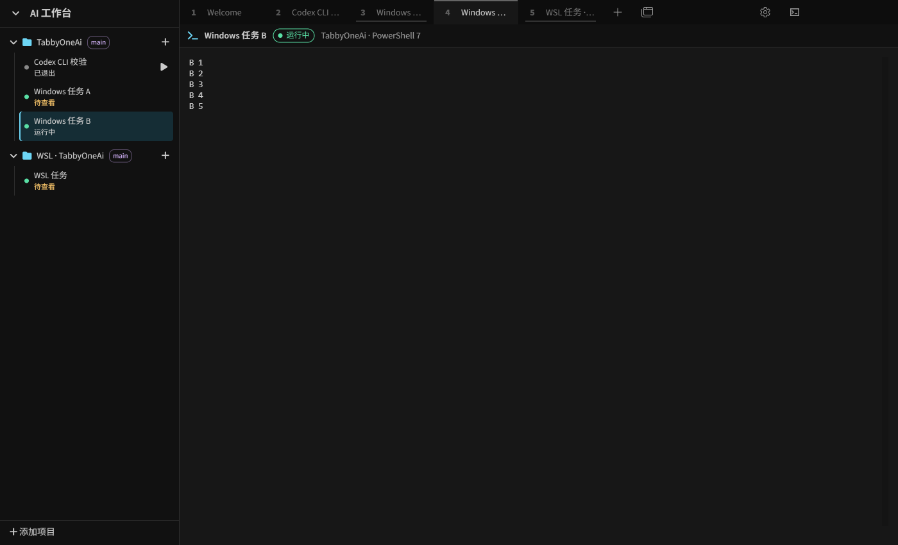

# v0.1 实机验收

验收环境为本机已安装的官方 Tabby `1.0.238.0`、PowerShell 7 和 WSL 2 `Ubuntu-24.04`。测试使用独立 Chromium 用户目录与 `TABBY_CONFIG_DIRECTORY`，通过 Tabby 插件目录加载 `tabby-oneai-0.1.0.tgz`。

## 通过项

| 场景 | 实机结果 |
| --- | --- |
| 加载插件 | 左侧 AI 工作台和标签下方的状态栏出现在官方应用内，工具栏提供工作台入口。 |
| 添加项目 | Windows 和 WSL 项目均可添加，任务在指定的 Windows 路径或 Linux 路径下启动。项目树显示当前 Git 分支。 |
| 真实 Codex CLI | 通过项目菜单在同一目录启动两个原生 Codex 交互进程。按操作系统进程树确认两者属于测试 Tabby，并从侧栏切回第一个。测试使用独立 `CODEX_HOME`。 |
| 终端并行 | 两个 PowerShell 7 测试任务和一个 WSL 测试任务同时在线。切走时还能收到输出，切回清除「待查看」。 |
| 原生分屏 | 通过 Tabby 原生命令合并标签，原 Windows 与 WSL 任务仍可分别从项目树定位，状态栏随焦点切换。 |
| 独立退出 | PowerShell 任务自行退出后，只有该任务显示「已退出」，另外两个任务继续在线。 |
| 布局与降级 | 折叠和展开侧栏时终端继续运行。模拟丢失宿主挂载点时，工具栏仍可打开工作台，恢复挂载点后侧栏重新出现。 |
| 主题 | 在 Tabby 深色主题下观察状态色，并在独立浅色 Tabby 实例中验证插件切换到浅色配色。 |
| 持久化 | 重载 Tabby 窗口后，两个项目和任务记录均可查看。独立测试配置关闭了宿主自动恢复标签，任务显示「已退出」。 |

## 验收范围

使用顶部标签布局与单窗口。真实 SSH 服务连接、跨 Tabby 版本、原生自动恢复已有 PTY 和其他 CLI 的会话解析由后续实机验收覆盖。账号、Tokens、额度及历史会话恢复归入 `v0.2`。
