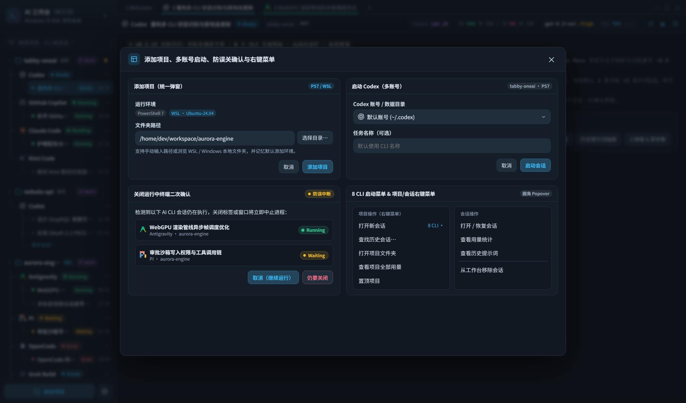
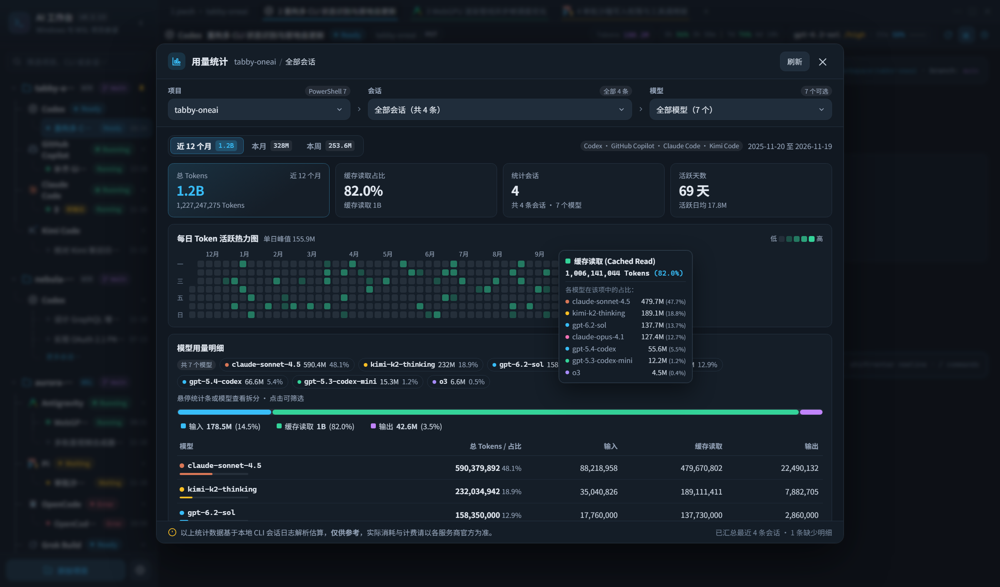
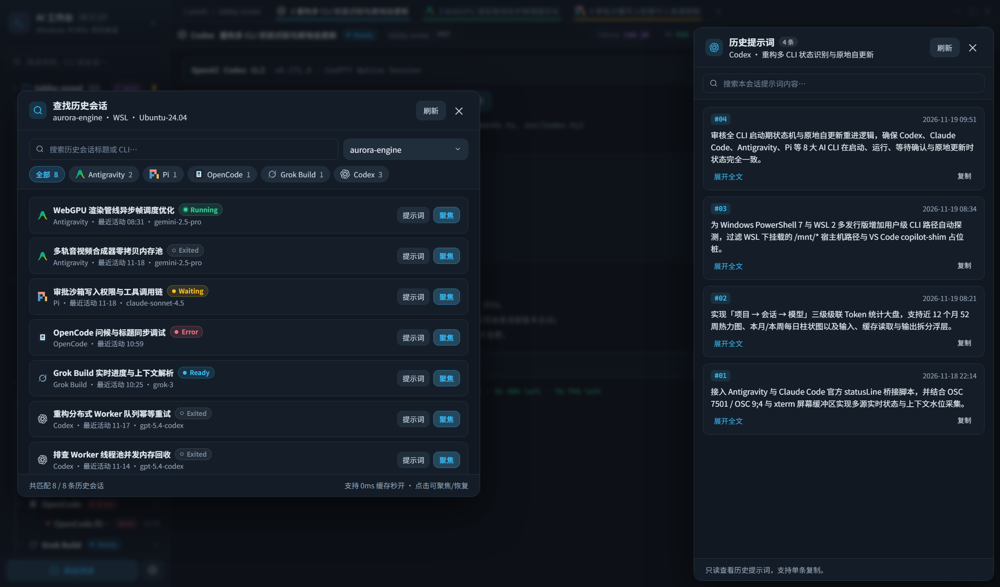
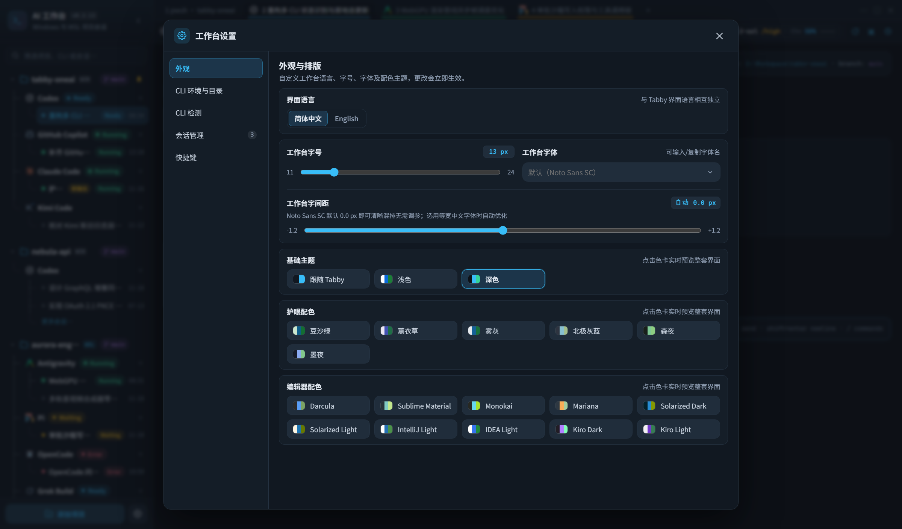
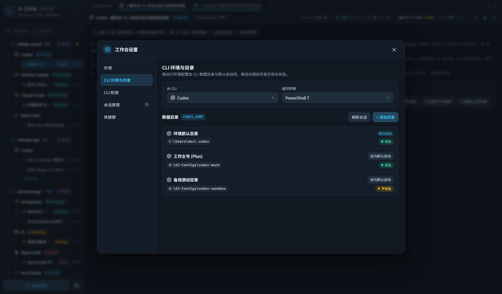
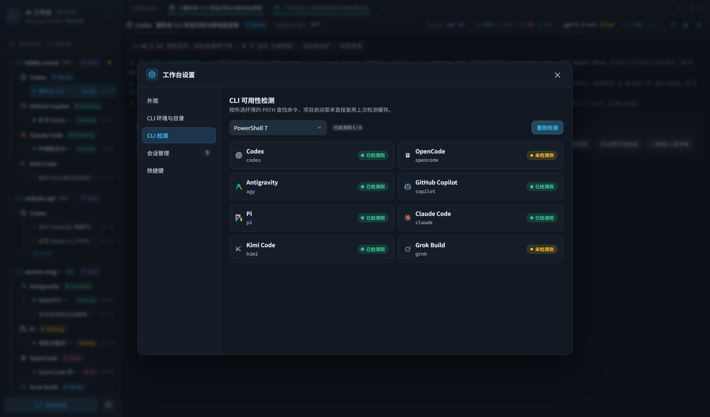
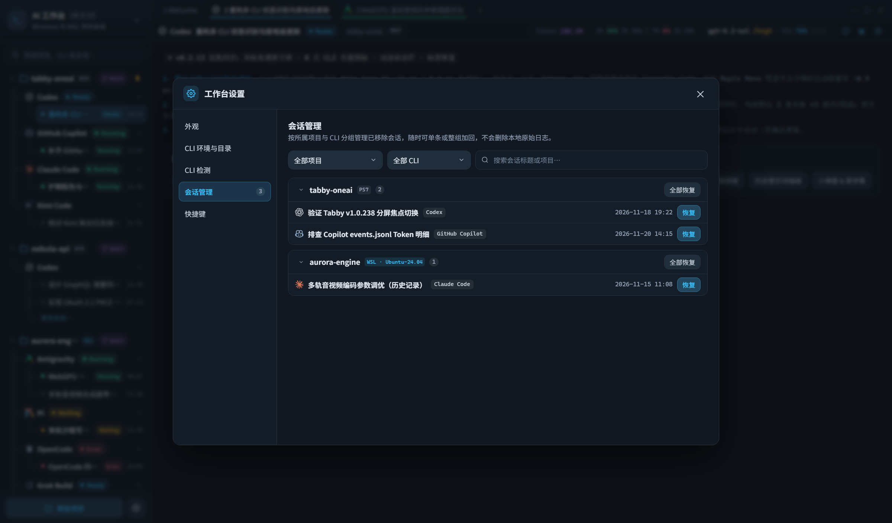

# User Guide & FAQ

**[English](USAGE.en.md) | [简体中文](USAGE.md)** · [Back to README](../README.en.md) · [Installation Guide](INSTALL.en.md)

---

## 1. Core Workflow

### 1. Add Projects (Windows & Multi-Distro WSL 2)
- **Project-First Hierarchy (`Project → AI CLI → Session`)**: The workbench is organized around your projects -- a single project can run multiple AI CLIs together, and each CLI can hold multiple active or historical sessions.
- Click **+ Add Project** at the bottom of the left sidebar, pick your runtime (`PowerShell 7` or any installed `WSL` distribution), and choose or enter your project folder.
- **Automatic Session Discovery**: Right after you add a project directory, you do not need to manually import anything -- the workbench **automatically scans and adds all historical sessions from supported AI CLIs** matching that folder, grouped by CLI alongside the Git branch and runtime badge (`WIN` / `WSL`).
- Click the **pin icon** on a project row to pin it to the top. Right-click any project to **Start New Session**, **Search Session History…**, **Open Project Folder** (auto-translating WSL paths to `\\wsl.localhost\...`), or **View Project Usage**.

### 2. Launch & Resume Sessions
- **New Session**: Right-click a project → **Start New Session** (only CLIs detected in that runtime are listed). Once your first message is written to disk, the sidebar title, prompt history drawer, and token counters bind automatically.
- **Resume History**: Double-click any historical session in the sidebar to resume it in a native Tabby tab using its exact directory, environment variables, and session ID. If already open, double-clicking focuses the existing pane.
- **Progressive List**: Each CLI group shows the latest `2` sessions by default; click **More sessions…** to expand in `+3` steps or **Collapse sessions** to fold back.

### 3. Understanding the 5 Runtime States & `New` Badges
All states stay synchronized across the **tab bottom `.colorbar`**, **session telemetry bar**, **sidebar CLI group pills**, and **session dots**:

| State | Color | Meaning |
| :--- | :---: | :--- |
| **`Running`** | Emerald | Agent is thinking, running tools, or executing background subagents (soft breathing tab bar) |
| **`Waiting`** | Amber | Agent is paused waiting for user confirmation or permission (`Allow once`, `[y/n]`) |
| **`Ready`** | Cyan-Blue | Session is live and idle at the prompt, ready for your next instruction |
| **`Error`** | Coral Red | The turn stopped on an API, quota, or auth error (auto-retries remain `Running`) |
| **`Exited`** | Hollow Grey | Historical/closed session (double-click to resume) |

- **`New` (`新输出`) Badge**: Lights up on background sessions when real background work finishes or enters `Waiting`; clears automatically when you view the tab.
- **Close Guard**: Attempting to close a tab or Tabby window while tasks are `Running` or `Waiting` opens a confirmation dialog to prevent accidentally killing active agents.

### 4. Telemetry Bar, Usage Dashboard & Prompt History Drawer
- **Live Telemetry Bar**: Dynamically renders only metric pills supported and populated by the active CLI (`Tokens`, `5h / 7d` quota & reset timers, `Model / Effort`, 3-color `Ctx` bar). Codex includes a manual online quota refresh button.
- **Usage Dashboard**: Click the `Tokens` pill or chart icon to filter cascadingly by **Project → Session → Model** across Last 12 Months (52-week heatmap), This Month, or This Week (daily bar charts), with hover tooltips detailing Input, Cache Read, and Output splits.

- **Prompt History Drawer & Global Session Search**: Click the clock icon (or press `Ctrl-Alt-Shift-H`) to slide out all user prompts for the active session in reverse chronological order with keyword search, expand/collapse, and one-click copy; right-click any project for `0 ms` cached cross-CLI session search.

### 5. Settings, Multi-Account Directories & Shortcuts
Click the **gear icon** at the bottom right of the sidebar (or press `Ctrl-Alt-Shift-O`):
- **Appearance**: Switch **简体中文 / English** independently of Tabby, adjust font size, search any installed system font, and pick from 16 Eye-Care & Editor themes.

- **CLI Directories**: Configure multiple data directories / accounts for `Codex`, `Claude Code`, `Pi`, `Kimi Code`, `Grok Build`, and `GitHub Copilot`, with real-time path existence badges.

- **CLI Detection**: Re-scan `PATH` per runtime (`PowerShell 7` or each `WSL` distro) whenever you install a new CLI.

- **Session Management**: Recover sessions previously removed from the workbench (grouped by project, one-click single or group restore).

- **Shortcuts**: Click any shortcut to record a new keybinding with conflict detection and one-click reset:

| Action | Default Shortcut |
| :--- | :--- |
| Collapse / Expand Project Sidebar | `Ctrl-Alt-Shift-B` |
| Open Session / Project Usage Analytics | `Ctrl-Alt-Shift-U` |
| Toggle Prompt History Drawer | `Ctrl-Alt-Shift-H` |
| Open Workbench Settings | `Ctrl-Alt-Shift-O` |

---

## 2. Frequently Asked Questions (FAQ)

### Q1: Why didn't my open AI sessions automatically reopen when I restarted Tabby?
Automatic session recovery relies on Tabby's built-in tab recovery setting:
- **Path**: **Tabby Settings (top-right gear icon)** → **Application** → enable **Recover tabs on startup**.
- Once enabled, restarting Tabby automatically reopens your Windows and WSL AI CLI tabs and re-attaches them to the workbench status bar and sidebar.

### Q2: If I set Tabby's Default Terminal Profile to WSL (or PowerShell), does it break session recovery for the other environment?
**Not at all.** Every project in AI Workbench binds its own runtime (`pwsh.exe` for Windows projects, `wsl.exe --distribution <distro>` for WSL projects). Tabby's default profile only applies when clicking the `+` button for a regular shell tab.

### Q3: I installed an AI CLI, why doesn't it appear in a project's launch menu?
1. **Check runtime isolation**: Windows and WSL environments are strictly isolated (WSL projects ignore mounted `/mnt/*` host binaries and VS Code `copilot-shim` stubs). A CLI installed only on Windows won't appear in WSL projects, and vice versa.
2. **Refresh detection cache**: If you installed the CLI after opening Tabby, go to **Workbench Settings → CLI Detection**, select the runtime, and click **Re-detect**.

### Q4: Exiting a CLI with `Ctrl+C`, `Esc`, or `/exit` closes the tab immediately -- is my conversation lost?
**No.** Closing the tab keeps your tab bar clean instead of leaving dead shell prompts behind. Your full transcript remains safely stored in the CLI's local history and appears as `Exited` in the sidebar -- double-click it anytime to resume with the exact same session ID.

### Q5: Does removing a session or project from the workbench delete my files or CLI logs?
**Never.** Removal only hides the item from the sidebar; no source code or CLI transcripts are deleted. You can restore removed sessions anytime under **Workbench Settings → Session Management**.

### Q6: What happens if an AI CLI prompts `Update now` (or I run `/update`) inside a session?
The workbench detects in-CLI self-updates across all 8 CLIs: it switches the task to `Running`, locks the tab from closing when the old process exits, and **automatically relaunches the newly updated CLI in-place inside the same tab** (or keeps the terminal output open if the update fails).

### Q7: Why are live metrics missing for Antigravity (`agy`) or Claude Code?
Their statusLine bridge scripts require `node` to be available inside the corresponding Windows or WSL environment (`node -v`).

### Q8: Why might Token totals differ slightly from my provider's official billing dashboard?
Usage analytics are parsed locally from CLI transcript files on disk. Some transcripts omit early metadata or provider-specific cache multipliers, so figures are **for reference only**.

---

## 3. Privacy & Security

- **100% Local Read-Only Parsing**: All histories, prompts, and token statistics are parsed locally from disk. No backend server exists and zero code, prompts, or telemetry are ever uploaded.
- **Zero Credential Access**: API keys, OAuth tokens, and auth sessions stay exclusively inside each AI CLI; the plugin never writes secrets or terminal scrollback to external files or logs.
- **Scoped Local Storage**: Project lists, appearance preferences, and custom directory mappings are stored only in the active Tabby profile's `localStorage`.
